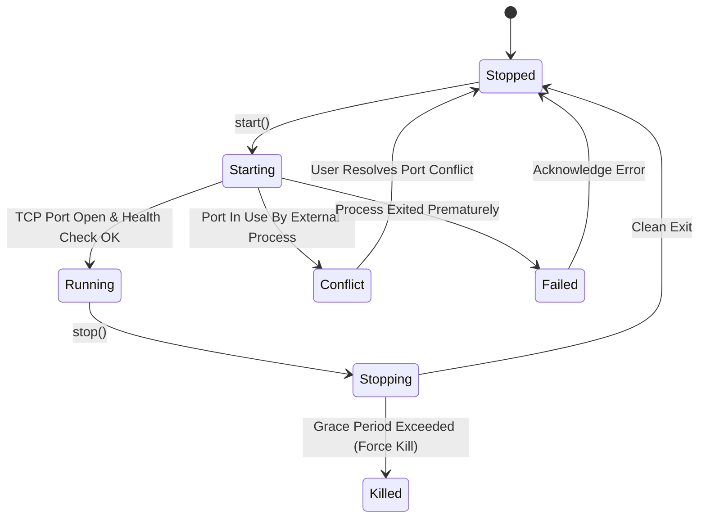

# BAMP: System Design Specification

## 1. Process Lifecycle State Machine

Each managed service (Nginx, PHP-FPM, MySQL, Mailpit) implements the following state transitions:



### 1.1 State Definitions
- **Stopped**: Process is not running; port is released.
- **Starting**: Process binary spawned; supervisor is polling the designated TCP port.
- **Running**: Process is active; port listener verified; PID tracked.
- **Stopping**: Graceful stop signal dispatched (`SIGQUIT` / `SIGTERM` / `taskkill`).
- **Conflict**: Target port is occupied by an external PID before spawning.
- **Failed**: Process terminated with a non-zero exit code or crashed unexpectedly.

## 2. Process Supervisor Design

### 2.1 Process Spawning & Isolation Strategy
The Supervisor must guarantee that under no circumstance does a service become an orphaned zombie process.

#### Windows Implementation:
```rust
// Pseudocode for Windows Job Object binding
use windows_sys::Win32::System::JobObjects::*;

let job = CreateJobObjectW(null(), null());
let mut info: JOBOBJECT_EXTENDED_LIMIT_INFORMATION = zeroed();
info.BasicLimitInformation.LimitFlags = JOB_OBJECT_LIMIT_KILL_ON_JOB_CLOSE;
SetInformationJobObject(
    job,
    JobObjectExtendedLimitInformation,
    &info as *const _ as *const _,
    size_of_val(&info) as u32,
);
AssignProcessToJobObject(job, child_process_handle);
```

#### Linux Implementation:
```rust
// Pseudocode for Linux process group assignment
use std::os::unix::process::CommandExt;
use std::process::Command;

let mut cmd = Command::new(&binary_path);
unsafe {
    cmd.pre_exec(|| {
        // Create new process group with child PID as PGID
        libc::setpgid(0, 0);
        Ok(())
    });
}
```

### 2.2 Health Check & Port Probing
When starting a service:
1. Probe the assigned TCP port (e.g. `127.0.0.1:3306`).
   - If port is open before launching, transition to `Conflict`, retrieve owning PID via `netstat` / `/proc/net/tcp`, and abort launch.
2. Spawn child process.
3. Poll port with exponential backoff (initial interval 25ms, max timeout 5000ms):
   - Attempt `TcpStream::connect("127.0.0.1:<port>")`.
   - If connection succeeds within timeout: transition to `Running`.
   - If timeout expires: inspect child process exit code; transition to `Failed` and capture stderr log.

## 3. Virtual Host Auto-Detection Engine

When a folder change is detected in `www/` or any registered Linked Folder:

### 3.1 Detection Rules
1. **Domain Derivation**:
   - Sanitize folder name: lowercase, replace spaces/underscores with hyphens.
   - Example: `My Portfolio Project` -> `my-portfolio-project.test`.
2. **Document Root Determination**:
   - If `<folder>/public/index.php` or `<folder>/public/index.html` exists -> Document Root is `<folder>/public` (Standard for Laravel, Symfony, modern frameworks).
   - Else if `<folder>/index.php` or `<folder>/index.html` exists -> Document Root is `<folder>` (Standard for WordPress, classic PHP).
   - Else -> Document Root is `<folder>` with directory browsing or fallback index.
3. **PHP Version Binding**:
   - If an explicit override is set for this site in BAMP configuration -> use assigned PHP-FPM socket/port.
   - Else -> use the globally active PHP-FPM socket.
4. **Configuration Generation**:
   - Render the `vhost.conf.template` with variables:
     - `{{domain}}`: e.g. `my-app.test`
     - `{{document_root}}`: sanitized absolute path
     - `{{fastcgi_pass}}`: `127.0.0.1:<php_port>` or `unix:/path/to/php-fpm.sock`
     - `{{ssl_cert}}`: path to wildcard `cert.pem`
     - `{{ssl_key}}`: path to wildcard `key.pem`
   - Atomically write to `data/nginx/vhosts/<domain>.conf`.
   - Send reload signal to Nginx: `nginx -s reload`.

## 4. Embedded DNS Server Engine

### 4.1 Packet Handling Logic
- Protocol: UDP over `127.0.0.1:53`.
- Parsing: Decode standard DNS Request Header and Question section.
- Matching:
  - If Question `QTYPE == A (1)` and `QNAME` ends with `.test` (case-insensitive):
    - Construct DNS Response Packet:
      - Flags: Standard query response, No error (`0x8180`).
      - Answer count: 1.
      - Answer RDATA: `4 bytes` = `[127, 0, 0, 1]`.
      - TTL: `60 seconds`.
    - Send response back to sender socket.
  - If query is for other TLDs or unsupported record types:
    - Return `RCODE 3 (NXDOMAIN)` or ignore if strictly serving local loopback.

## 5. SSL Engine & Trust Store Integration

### 5.1 Certificate Hierarchy
1. **BAMP Root CA**:
   - Common Name (CN): `BAMP Local Development Root CA`
   - Validity: 10 years.
   - Basic Constraints: `CA:TRUE`, Key Usage: `Digital Signature, Certificate Signing, CRL Signing`.
2. **Wildcard Domain Certificate**:
   - Subject Alternative Names (SAN): `DNS:*.test, DNS:localhost, IP:127.0.0.1`
   - Signed by: BAMP Root CA private key.
   - Validity: 2 years.

### 5.2 System Trust Injection Steps
- **Windows**:
  - Command: `certutil -addstore -f "Root" "data/ssl/bamp-root-ca.crt"`
- **Linux**:
  - Copy `bamp-root-ca.crt` to `/usr/local/share/ca-certificates/bamp-root-ca.crt`.
  - Execute: `update-ca-certificates`.
  - For NSS stores (Firefox / Chrome): add to `cert9.db` via `certutil -A -n "BAMP Root CA" -t "C,," -i "bamp-root-ca.crt" -d sql:$HOME/.pki/nssdb`.
